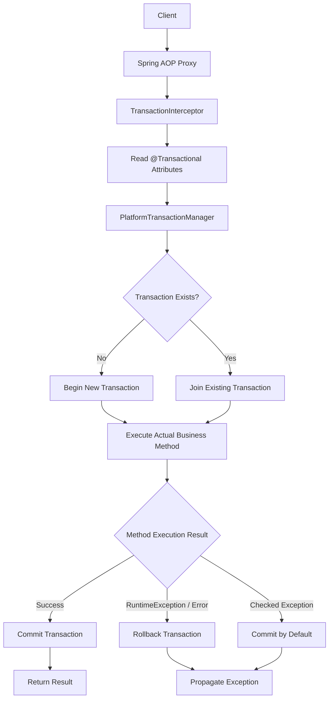
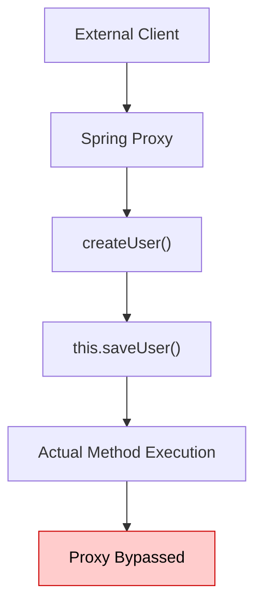
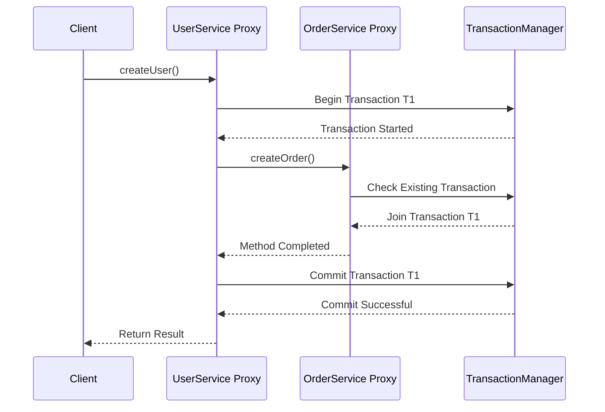

# Spring Boot Interview Questions
Spring Boot interview questions and answers for Java developers.

## Table of Contents

<!-- TOC_START -->
| No. | Questions |
| --- | --------- |
| 1 | [Spring Framework – Key Features](#1-spring-framework--key-features) |
| 2 | [What is Spring IoC Container?](#2-what-is-spring-ioc-container) |
| 3 | [What is Dependency Injection (DI) in Spring?](#3-what-is-dependency-injection-di-in-spring) |
| 4 | [What is Bean Scope in Spring?](#4-what-is-bean-scope-in-spring) |
| 5 | [Spring Bean Lifecycle](#5-spring-bean-lifecycle) |
| 6 | [Spring Boot Features](#6-spring-boot-features) |
| 7 | [Important Spring Boot Annotations](#7-important-spring-boot-annotations) |
| 8 | [How @Transactional works internally?](#8-how-transactional-works-internally) |
<!-- TOC_END -->
<!-- QUESTIONS_START -->
## Spring Framework

### 1. Spring Framework – Key Features

Spring Framework is a powerful, open-source Java framework used to develop enterprise-level applications. It simplifies Java development by providing infrastructure support, dependency management, transaction management, and integration with other technologies.

#### **Advantages of Spring Framework**
- Lightweight and modular framework.
- Supports loose coupling.
- Makes code reusable and maintainable.
- Simplifies database connectivity.
- Supports transaction management.
- Easy integration with other frameworks.
- Supports unit testing.
- Helps develop scalable enterprise applications.

#### **Major Features of Spring Framework**

#### 1. Inversion of Control (IoC)
- IoC is the core feature of Spring.
- It transfers the responsibility of creating and managing objects from the developer to the Spring container.
- Spring manages object creation and their lifecycle.

#### 2. Dependency Injection (DI)
- DI is a design pattern used to achieve loose coupling.
- Spring automatically provides the required dependencies to objects.
- Types of dependency injection:
  - Constructor Injection
  - Setter Injection
  - Field Injection

#### 3. Aspect-Oriented Programming (AOP)
- AOP separates cross-cutting concerns from business logic.
- It helps manage common functionalities such as:
  - Logging
  - Security
  - Transaction Management
  - Exception Handling

#### 4. Spring MVC
- Spring MVC is used to develop web applications.
- It follows the Model-View-Controller architecture.
- It separates application logic, user interface, and request handling.

#### 5. Transaction Management
- Spring provides a consistent way to manage database transactions.
- It supports declarative and programmatic transaction management.
- It helps maintain data consistency.

#### 6. JDBC Support
- Spring simplifies database connectivity using JDBC.
- It reduces boilerplate code.
- It provides exception handling and resource management.

#### 7. ORM Integration
- Spring supports ORM frameworks such as:
  - Hibernate
  - JPA
  - MyBatis
- It simplifies database operations and object-relational mapping.

#### 8. Spring Security
- Provides authentication and authorization.
- Protects applications from unauthorized access.
- Supports role-based access control.

#### 9. Spring Container
- The Spring container creates, configures, and manages application objects called beans.
- Main container interfaces:
  - BeanFactory
  - ApplicationContext

#### 10. Easy Integration
Spring integrates with various technologies, such as:
- Hibernate
- JDBC
- JPA
- REST APIs
- JMS

[⬆ Back to Table](#table-of-contents)


### 2. What is Spring IoC Container?

#### 1. Introduction

Spring IoC (Inversion of Control) Container is the core part of the Spring Framework that is responsible for creating, configuring, managing, and destroying objects (called Beans) in a Java application.

Instead of creating objects manually using the `new` keyword, the Spring IoC Container creates objects and provides their required dependencies automatically.

#### 2. Main Responsibilities of IoC Container

1. **Object Creation:** Creates objects (beans) of classes.
2. **Dependency Injection:** Injects the required dependencies into objects.
3. **Bean Configuration:** Configures beans using XML, annotations, or Java configuration.
4. **Bean Lifecycle Management:** Manages the complete lifecycle of beans.
5. **Object Management:** Maintains and manages application objects.

#### 3. Types of Spring IoC Containers

Spring provides two main types of IoC containers:

##### i. BeanFactory

- It is the basic IoC container.
- It provides basic dependency injection functionality.
- Beans are generally created lazily when requested.

##### ii. ApplicationContext

- It is an advanced IoC container.
- It provides all the features of BeanFactory.
- It supports internationalization, event handling, and easier integration with Spring features.
- It is commonly used in Spring applications.

#### 4. Working of Spring IoC Container

- Developer defines beans using XML, annotations, or Java configuration.
- Spring IoC Container reads the configuration.
- Container creates the required objects.
- Container injects dependencies into objects.
- Application uses the managed objects.

#### 5. Advantages of Spring IoC Container

- Reduces tight coupling between classes.
- Supports Dependency Injection.
- Makes code reusable and maintainable.
- Simplifies object creation and management.
- Makes unit testing easier.
- Manages bean lifecycle automatically.

#### 6. Difference Between BeanFactory and ApplicationContext

| BeanFactory | ApplicationContext |
|---|---|
| Basic IoC container | Advanced IoC container |
| Supports dependency injection | Supports dependency injection |
| Generally uses lazy initialization | Commonly uses eager singleton initialization |
| Provides basic features | Provides additional features |
| Less commonly used directly | Widely used in Spring applications |


[⬆ Back to Table](#table-of-contents)


### 3. What is Dependency Injection (DI) in Spring?

#### 1. Introduction

- Dependency Injection (DI) is a design pattern in Spring Framework in which the Spring IoC Container automatically provides the required dependencies (objects) to another object instead of the object creating them manually.
- It helps achieve **loose coupling** between classes and makes applications easier to maintain, test, and reuse.
- Without Dependency Injection, one class creates the object of another class using the `new` keyword.
- With Dependency Injection, Spring provides the object automatically.

#### 2. Types of Dependency Injection in Spring

Spring supports three commonly discussed types of Dependency Injection:

##### i. Constructor Injection
- Dependencies are provided through a constructor.
- It is recommended for mandatory dependencies.
- It helps create immutable objects.
- It makes unit testing easier.

##### ii. Setter Injection
- Dependencies are provided using setter methods.
- Useful for optional dependencies.
- Dependencies can be changed after object creation.

##### iii. Field Injection
- Dependencies are provided directly to class fields using the `@Autowired` annotation.
- Requires less code.
- Generally not recommended because it makes unit testing and dependency management harder.

#### 3. Advantages of Dependency Injection
- Reduces tight coupling between classes.
- Improves code reusability.
- Makes applications easier to maintain.
- Makes unit testing easier.
- Simplifies object management.
- Supports loose coupling and flexibility.
#### 4. How Dependency Injection Works in Spring

- Developer creates classes and defines their dependencies.
- Spring IoC Container scans and identifies Spring beans.
- Spring creates the required objects.
- Spring injects the dependent objects automatically.
- Application uses the injected objects.

#### 5. Cyclic Dependency
- Cyclic Dependency occurs when two or more Spring beans depend on each other directly or indirectly. It can cause bean creation errors, especially with constructor injection.
- It can sometimes be resolved using `@Lazy` or setter injection, but the best practice is to redesign the application to remove unnecessary circular dependencies.


[⬆ Back to Table](#table-of-contents)

### 4. What is Bean Scope in Spring?
In Spring Framework, Bean Scope defines the lifecycle and visibility of a Spring Bean. In simple terms, it determines how many instances of a bean Spring creates and how long those instances are maintained.

#### **Types of Bean Scopes in Spring**

| Scope | Description |
|---|---|
| Singleton | Only one instance of the bean per Spring IoC container. |
| Prototype | A new instance is created every time the bean is requested from the container. |
| Request | One instance per HTTP request. |
| Session | One instance per HTTP session. |
| Application | One instance per ServletContext. |
| WebSocket | One instance per WebSocket session. |

##### **i. Singleton Scope (Default)**
- Singleton is the default scope in Spring.
- Only one instance is created per Spring IoC container.
```java
@Component
@Scope("singleton")
public class UserService {
    public UserService() {
        System.out.println("UserService Created");
    }
}
```
##### **ii. Prototype Scope**
- In prototype scope, Spring creates a new object every time the bean is requested from the container.
- Spring manages prototype bean creation and dependency injection, but does not manage their complete destruction lifecycle.
```java
@Component
@Scope("prototype")
public class UserService {
    public UserService() {
        System.out.println("UserService Created");
    }
}
```
##### **iii. Request Scope**
- A new bean instance is created for every HTTP request.
- Useful when storing request-specific information.
```java
@Component
@RequestScope
public class UserService {
}
```
##### **iv. Session Scope**
- A new bean instance is created for each HTTP session.
- Useful for maintaining user-specific session information.
```java
@Component
@SessionScope
public class UserSession {
}
```
##### **v. Application Scope**
- One bean instance is created per ServletContext.
- Useful for sharing application-level data across requests and sessions within the same web application.
```java
@Component
@ApplicationScope
public class ApplicationService {
}
```
##### **vi. WebSocket Scope**
- A separate bean instance is created for each WebSocket session.
- Useful for maintaining WebSocket session-specific information.
```java
@Component
@Scope("websocket")
public class WebSocketService {
}
```
#### **Real-World Example**
Imagine an e-commerce application.

- **Singleton**: PaymentService – shared service instance.
- **Prototype**: ShoppingCartHelper – a fresh helper object whenever requested.
- **Request**: RequestData – information specific to an HTTP request.
- **Session**: UserSession – information specific to a logged-in user's session.
- **Application**: ApplicationConfig – application-wide information.
- **WebSocket**: ChatSession – information specific to a WebSocket connection.

[⬆ Back to Table](#table-of-contents)

### 5. Spring Bean Lifecycle
The Spring Bean Lifecycle refers to the sequence of steps Spring Framework follows from creating a bean (object) to destroying it. Spring IoC Container manages the complete lifecycle of beans.

The lifecycle follows these steps:

- **Instantiation** – Spring creates the bean object using a constructor.
- **Populate Properties** – Spring injects dependencies using Dependency Injection.
- **Aware Interfaces** – Spring calls relevant aware methods, such as:
    - `BeanNameAware`
    - `BeanFactoryAware`
    - `ApplicationContextAware`
- **BeanPostProcessor (Before Initialization)** – Calls `postProcessBeforeInitialization()`.
- **Initialization** – Spring initializes the bean using:
    - `@PostConstruct`
    - `InitializingBean.afterPropertiesSet()`
    - Custom `init()`-method

- **BeanPostProcessor (After Initialization)** – Calls `postProcessAfterInitialization()`.
- **Bean Ready** – The bean is ready to be used by the application.
- **Destruction** – When the container shuts down, Spring calls:
    - `@PreDestroy`
    - `DisposableBean.destroy()`
    - Custom `destroy()`-method

[⬆ Back to Table](#table-of-contents)

## Spring Boot


### 6. Spring Boot Features

Spring Boot provides several powerful features that simplify Spring application development. It reduces boilerplate configuration and helps developers build standalone, production-ready applications quickly.

#### 1. Auto-Configuration

- Spring Boot automatically configures application components based on the dependencies available in the classpath.
- It reduces the need for manual configuration.
- We can override the default configuration whenever required.

**Example:**

If we add `spring-boot-starter-web`, Spring Boot automatically configures components required for a web application, including Spring MVC and an embedded web server.

#### 2. Starter Dependencies

- Starters are predefined dependency descriptors.
- They group commonly required dependencies for specific functionalities.
- They simplify dependency management.

**Examples:**

| Starter | Purpose |
|---|---|
| spring-boot-starter-web | REST API and web applications |
| spring-boot-starter-data-jpa | Database operations using JPA |
| spring-boot-starter-security | Application security |
| spring-boot-starter-test | Application testing |
| spring-boot-starter-validation | Bean validation |

#### 3. Embedded Servers

- Spring Boot provides embedded web servers.
- We don't need to install and configure an external server separately.
- We can run the application as a standalone executable JAR.

**Supported servers:**
- Tomcat (default for Spring MVC web applications)
- Jetty
- Undertow

#### 4. Spring Boot Actuator

- Actuator provides production-ready monitoring and management features.
- It helps monitor application health, metrics and other operational information.

**Common endpoints:**

- `/actuator/health`
- `/actuator/info`
- `/actuator/metrics`
- `/actuator/env`

#### 5. Externalized Configuration

- Spring Boot allows us to manage application configuration outside the source code.
- We can use `application.properties` or `application.yml`.
- We can also use environment variables and command-line arguments.

**Example:**

```properties
server.port=8081
spring.application.name=employee-service
```

#### 6. Spring Profiles

- Profiles allow us to maintain different configurations for different environments.
- We can define separate configurations for development, testing and production.

**Example:**

```text
application-dev.properties
application-test.properties
application-prod.properties
```

Activate a profile:

```properties
spring.profiles.active=dev
```

#### 7. Minimal XML Configuration

- Spring Boot primarily uses Java-based configuration and annotations.
- It reduces the need for traditional XML configuration files.

#### 8. Spring Boot CLI

- Spring Boot CLI allows developers to run Spring applications using command-line tools.
- It supports rapid application development using Groovy.

#### 9. Production-Ready Features

- Spring Boot provides features that help prepare applications for production.
- Actuator provides health checks, metrics and monitoring endpoints.
- It also supports externalized configuration and logging.

#### 10. Easy Integration

Spring Boot integrates easily with several technologies and frameworks.

**Examples:**
- Spring Data JPA
- Spring Security
- Spring Cloud
- Hibernate
- MySQL
- MongoDB
- Kafka


[⬆ Back to Table](#table-of-contents)

### 7. Important Spring Boot Annotations
#### **1. @SpringBootApplication**
`@SpringBootApplication` is a core annotation in Spring Boot that marks the main class of a Spring Boot application. It tells Spring Boot to enable auto-configuration, component scanning, and configuration support.

It is a combination of three annotations:
- `@SpringBootConfiguration`
    - Indicates that the class provides Spring configuration.
    - It is a specialized form of `@Configuration`.
    - Allows you to define Spring beans using `@Bean`.
- `@EnableAutoConfiguration`
    - Automatically configures your application based on the dependencies available in the classpath.
    - Reduces the need for manual configuration.
    - **Example**: If you add `spring-boot-starter-web`, Spring Boot automatically configures web-related components such as the embedded Tomcat server and Spring MVC.
- `@ComponentScan`
    - Scans the current package and its subpackages for Spring components.
    - Detects annotations such as: `@Component`, `@Service`, `@Repository`, `@Controller`, `@RestController`

#### **2. Spring Stereotype Annotations**
Stereotype Annotations are used to identify a Java class as a Spring-managed component (Spring Bean).
The main Spring Stereotype Annotations are:
- `@Component`
    - It is a generic stereotype annotation.
    - Used to mark a Java class as a Spring Bean.
    - Spring automatically detects the class during component scanning.
- `@Service`
    - Used to mark a class as a Service Layer component.
    - Generally contains business logic.
    - Internally, it is a specialization of `@Component`.
- `@Repository`
    - Used to mark a class as a Data Access Layer component (DAO).
    - Responsible for database operations.
    - Supports automatic translation of persistence-related exceptions into Spring's `DataAccessException` hierarchy.
- `@Controller`
    - Used to mark a class as a Spring MVC Controller.
    - Handles incoming HTTP requests.
    - Generally returns a view name.
- `@RestController`
    - Used to develop RESTful web services.
    - Returns data directly as JSON or XML (depending on configuration).
    - It is a combination of: `@Controller` and `@ResponseBody`

#### **3. @Primary annd @Qualifier Annotations**
In Spring Framework, `@Primary` and `@Qualifier` annotations are used to resolve Bean ambiguity during Dependency Injection.
- **@Primary Annotation**
    - `@Primary` tells Spring that a particular bean should be preferred when multiple beans of the same type are available for dependency injection.
- **@Qualifier Annotation**
    - `@Qualifier` is used to specify exactly which bean should be injected when multiple beans of the same type are available.
    - `@Qualifier` explicitly specifies the bean. It takes precedence over the default preference provided by `@Primary`.

Imagine an e-commerce application supporting three payment methods:

- Credit Card
- UPI
- Net Banking

You can use `@Primary` to define the default payment method and `@Qualifier("upi")` to select a particular payment method wherever required.


[⬆ Back to Table](#table-of-contents)

### 8. How @Transactional works internally?
- Spring implements `@Transactional` using AOP (Aspect-Oriented Programming) and proxy-based transaction management.
- Whenever Spring detects a bean containing the `@Transactional` annotation, it creates a proxy around that bean. Depending on the configuration, Spring uses either JDK Dynamic Proxy or CGLIB.
- When a client calls a transactional method, the call first goes through the Spring proxy rather than directly invoking the actual method.
- The proxy delegates the invocation to TransactionInterceptor, which reads the transaction configuration, such as propagation, isolation, and rollback rules.
- Then it communicates with the appropriate PlatformTransactionManager, which starts a new transaction or joins an existing transaction.
- After that, the actual business method executes.
- If the method completes successfully, Spring commits the transaction. If an exception occurs, Spring checks the rollback rules and rolls back the transaction if applicable.
- By default, Spring rolls back for `RuntimeException` and Error. Checked exceptions do not trigger rollback unless we explicitly configure rollbackFor.
- In Spring's default proxy-based transaction management, private methods cannot be intercepted as transactional methods. Public methods are the recommended approach.


#### What happens if we call a @Transactional method from another method in the same class?
That is called self-invocation. Since Spring uses proxy-based AOP, an internal method call using this bypasses the proxy. Therefore, the transactional annotation on the internally invoked method is not intercepted.


#### Transaction Propagation - REQUIRED
`Propagation.REQUIRED` is the default propagation. It joins an existing transaction if one exists; otherwise, it creates a new transaction.


#### Remember this execution chain

**Client → Spring Proxy → TransactionInterceptor → TransactionManager → Business Method → Commit / Rollback**


[⬆ Back to Table](#table-of-contents)

<!-- QUESTIONS_END -->