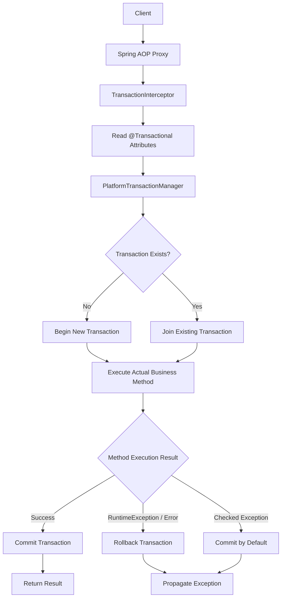
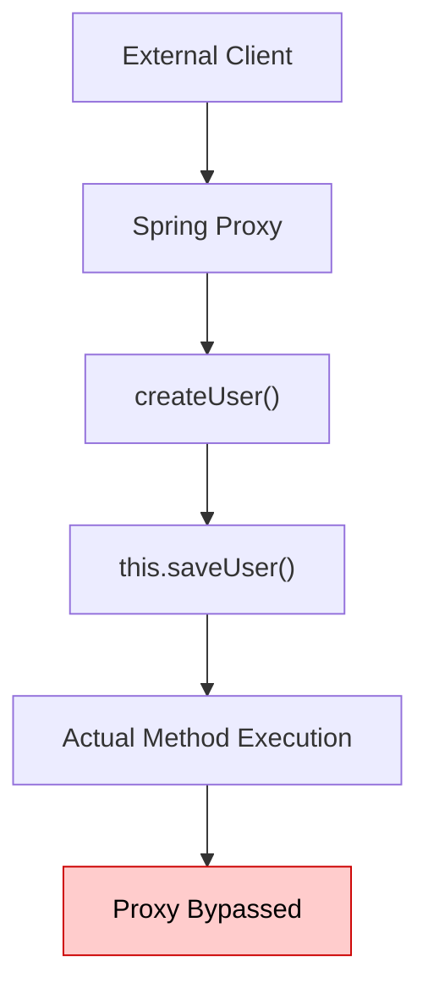
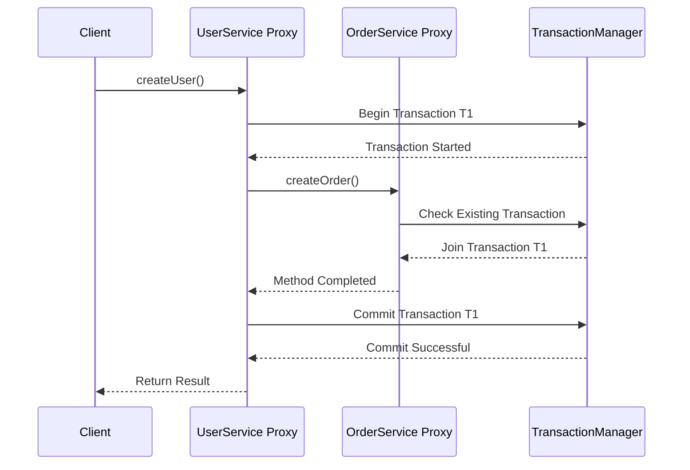

# Spring Boot Interview Questions
Spring Boot interview questions and answers for Java developers.

## Table of Contents

<!-- TOC_START -->
| No. | Questions |
| --- | --------- |
| 1 | [Spring Framework – Key Features](#1-spring-framework--key-features) |
| 2 | [What is Spring IoC Container?](#2-what-is-spring-ioc-container) |
| 3 | [What is Dependency Injection (DI) in Spring?](#3-what-is-dependency-injection-di-in-spring) |
| 4 | [What is Bean Scope in Spring?](#4-what-is-bean-scope-in-spring) |
| 5 | [Spring Bean Lifecycle](#5-spring-bean-lifecycle) |
| 6 | [Spring Boot Features](#6-spring-boot-features) |
| 7 | [Important Spring Boot Annotations](#7-important-spring-boot-annotations) |
| 8 | [How @Transactional works internally?](#8-how-transactional-works-internally) |
| 9 | [What is the N+1 Query Problem?](#9-what-is-the-n1-query-problem) |
| 10 | [What is a Database Index?](#10-what-is-a-database-index) |
| 11 | [Optimistic vs Pessimistic Locking](#11-optimistic-vs-pessimistic-locking) |
| 12 | [Sharding vs Partitioning](#12-sharding-vs-partitioning) |
| 13 | [ACID Properties](#13-acid-properties) |
| 14 | [API Gateway and Service Discovery](#14-api-gateway-and-service-discovery) |
| 15 | [What is a Distributed Transaction?](#15-what-is-a-distributed-transaction) |
| 16 | [What is the Transactional Outbox Pattern?](#16-what-is-the-transactional-outbox-pattern) |
| 17 | [Circuit Breaker Pattern](#17-circuit-breaker-pattern) |
| 18 | [Bulkhead Pattern](#18-bulkhead-pattern) |
| 19 | [Retry Pattern](#19-retry-pattern) |
<!-- TOC_END -->
<!-- QUESTIONS_START -->
## Spring Framework

### 1. Spring Framework – Key Features

Spring Framework is a powerful, open-source Java framework used to develop enterprise-level applications. It simplifies Java development by providing infrastructure support, dependency management, transaction management, and integration with other technologies.

#### **Advantages of Spring Framework**
- Lightweight and modular framework.
- Supports loose coupling.
- Makes code reusable and maintainable.
- Simplifies database connectivity.
- Supports transaction management.
- Easy integration with other frameworks.
- Supports unit testing.
- Helps develop scalable enterprise applications.

#### **Major Features of Spring Framework**

#### 1. Inversion of Control (IoC)
- IoC is the core feature of Spring.
- It transfers the responsibility of creating and managing objects from the developer to the Spring container.
- Spring manages object creation and their lifecycle.

#### 2. Dependency Injection (DI)
- DI is a design pattern used to achieve loose coupling.
- Spring automatically provides the required dependencies to objects.
- Types of dependency injection:
  - Constructor Injection
  - Setter Injection
  - Field Injection

#### 3. Aspect-Oriented Programming (AOP)
- AOP separates cross-cutting concerns from business logic.
- It helps manage common functionalities such as:
  - Logging
  - Security
  - Transaction Management
  - Exception Handling

#### 4. Spring MVC
- Spring MVC is used to develop web applications.
- It follows the Model-View-Controller architecture.
- It separates application logic, user interface, and request handling.

#### 5. Transaction Management
- Spring provides a consistent way to manage database transactions.
- It supports declarative and programmatic transaction management.
- It helps maintain data consistency.

#### 6. JDBC Support
- Spring simplifies database connectivity using JDBC.
- It reduces boilerplate code.
- It provides exception handling and resource management.

#### 7. ORM Integration
- Spring supports ORM frameworks such as:
  - Hibernate
  - JPA
  - MyBatis
- It simplifies database operations and object-relational mapping.

#### 8. Spring Security
- Provides authentication and authorization.
- Protects applications from unauthorized access.
- Supports role-based access control.

#### 9. Spring Container
- The Spring container creates, configures, and manages application objects called beans.
- Main container interfaces:
  - BeanFactory
  - ApplicationContext

#### 10. Easy Integration
Spring integrates with various technologies, such as:
- Hibernate
- JDBC
- JPA
- REST APIs
- JMS

[⬆ Back to Table](#table-of-contents)


### 2. What is Spring IoC Container?

#### 1. Introduction

Spring IoC (Inversion of Control) Container is the core part of the Spring Framework that is responsible for creating, configuring, managing, and destroying objects (called Beans) in a Java application.

Instead of creating objects manually using the `new` keyword, the Spring IoC Container creates objects and provides their required dependencies automatically.

#### 2. Main Responsibilities of IoC Container

1. **Object Creation:** Creates objects (beans) of classes.
2. **Dependency Injection:** Injects the required dependencies into objects.
3. **Bean Configuration:** Configures beans using XML, annotations, or Java configuration.
4. **Bean Lifecycle Management:** Manages the complete lifecycle of beans.
5. **Object Management:** Maintains and manages application objects.

#### 3. Types of Spring IoC Containers

Spring provides two main types of IoC containers:

##### i. BeanFactory

- It is the basic IoC container.
- It provides basic dependency injection functionality.
- Beans are generally created lazily when requested.

##### ii. ApplicationContext

- It is an advanced IoC container.
- It provides all the features of BeanFactory.
- It supports internationalization, event handling, and easier integration with Spring features.
- It is commonly used in Spring applications.

#### 4. Working of Spring IoC Container

- Developer defines beans using XML, annotations, or Java configuration.
- Spring IoC Container reads the configuration.
- Container creates the required objects.
- Container injects dependencies into objects.
- Application uses the managed objects.

#### 5. Advantages of Spring IoC Container

- Reduces tight coupling between classes.
- Supports Dependency Injection.
- Makes code reusable and maintainable.
- Simplifies object creation and management.
- Makes unit testing easier.
- Manages bean lifecycle automatically.

#### 6. Difference Between BeanFactory and ApplicationContext

| BeanFactory | ApplicationContext |
|---|---|
| Basic IoC container | Advanced IoC container |
| Supports dependency injection | Supports dependency injection |
| Generally uses lazy initialization | Commonly uses eager singleton initialization |
| Provides basic features | Provides additional features |
| Less commonly used directly | Widely used in Spring applications |


[⬆ Back to Table](#table-of-contents)


### 3. What is Dependency Injection (DI) in Spring?

#### 1. Introduction

- Dependency Injection (DI) is a design pattern in Spring Framework in which the Spring IoC Container automatically provides the required dependencies (objects) to another object instead of the object creating them manually.
- It helps achieve **loose coupling** between classes and makes applications easier to maintain, test, and reuse.
- Without Dependency Injection, one class creates the object of another class using the `new` keyword.
- With Dependency Injection, Spring provides the object automatically.

#### 2. Types of Dependency Injection in Spring

Spring supports three commonly discussed types of Dependency Injection:

##### i. Constructor Injection
- Dependencies are provided through a constructor.
- It is recommended for mandatory dependencies.
- It helps create immutable objects.
- It makes unit testing easier.

##### ii. Setter Injection
- Dependencies are provided using setter methods.
- Useful for optional dependencies.
- Dependencies can be changed after object creation.

##### iii. Field Injection
- Dependencies are provided directly to class fields using the `@Autowired` annotation.
- Requires less code.
- Generally not recommended because it makes unit testing and dependency management harder.

#### 3. Advantages of Dependency Injection
- Reduces tight coupling between classes.
- Improves code reusability.
- Makes applications easier to maintain.
- Makes unit testing easier.
- Simplifies object management.
- Supports loose coupling and flexibility.
#### 4. How Dependency Injection Works in Spring

- Developer creates classes and defines their dependencies.
- Spring IoC Container scans and identifies Spring beans.
- Spring creates the required objects.
- Spring injects the dependent objects automatically.
- Application uses the injected objects.

#### 5. Cyclic Dependency
- Cyclic Dependency occurs when two or more Spring beans depend on each other directly or indirectly. It can cause bean creation errors, especially with constructor injection.
- It can sometimes be resolved using `@Lazy` or setter injection, but the best practice is to redesign the application to remove unnecessary circular dependencies.


[⬆ Back to Table](#table-of-contents)

### 4. What is Bean Scope in Spring?
In Spring Framework, Bean Scope defines the lifecycle and visibility of a Spring Bean. In simple terms, it determines how many instances of a bean Spring creates and how long those instances are maintained.

#### **Types of Bean Scopes in Spring**

| Scope | Description |
|---|---|
| Singleton | Only one instance of the bean per Spring IoC container. |
| Prototype | A new instance is created every time the bean is requested from the container. |
| Request | One instance per HTTP request. |
| Session | One instance per HTTP session. |
| Application | One instance per ServletContext. |
| WebSocket | One instance per WebSocket session. |

##### **i. Singleton Scope (Default)**
- Singleton is the default scope in Spring.
- Only one instance is created per Spring IoC container.
```java
@Component
@Scope("singleton")
public class UserService {
    public UserService() {
        System.out.println("UserService Created");
    }
}
```
##### **ii. Prototype Scope**
- In prototype scope, Spring creates a new object every time the bean is requested from the container.
- Spring manages prototype bean creation and dependency injection, but does not manage their complete destruction lifecycle.
```java
@Component
@Scope("prototype")
public class UserService {
    public UserService() {
        System.out.println("UserService Created");
    }
}
```
##### **iii. Request Scope**
- A new bean instance is created for every HTTP request.
- Useful when storing request-specific information.
```java
@Component
@RequestScope
public class UserService {
}
```
##### **iv. Session Scope**
- A new bean instance is created for each HTTP session.
- Useful for maintaining user-specific session information.
```java
@Component
@SessionScope
public class UserSession {
}
```
##### **v. Application Scope**
- One bean instance is created per ServletContext.
- Useful for sharing application-level data across requests and sessions within the same web application.
```java
@Component
@ApplicationScope
public class ApplicationService {
}
```
##### **vi. WebSocket Scope**
- A separate bean instance is created for each WebSocket session.
- Useful for maintaining WebSocket session-specific information.
```java
@Component
@Scope("websocket")
public class WebSocketService {
}
```
#### **Real-World Example**
Imagine an e-commerce application.

- **Singleton**: PaymentService – shared service instance.
- **Prototype**: ShoppingCartHelper – a fresh helper object whenever requested.
- **Request**: RequestData – information specific to an HTTP request.
- **Session**: UserSession – information specific to a logged-in user's session.
- **Application**: ApplicationConfig – application-wide information.
- **WebSocket**: ChatSession – information specific to a WebSocket connection.

[⬆ Back to Table](#table-of-contents)

### 5. Spring Bean Lifecycle
The Spring Bean Lifecycle refers to the sequence of steps Spring Framework follows from creating a bean (object) to destroying it. Spring IoC Container manages the complete lifecycle of beans.

The lifecycle follows these steps:

- **Instantiation** – Spring creates the bean object using a constructor.
- **Populate Properties** – Spring injects dependencies using Dependency Injection.
- **Aware Interfaces** – Spring calls relevant aware methods, such as:
    - `BeanNameAware`
    - `BeanFactoryAware`
    - `ApplicationContextAware`
- **BeanPostProcessor (Before Initialization)** – Calls `postProcessBeforeInitialization()`.
- **Initialization** – Spring initializes the bean using:
    - `@PostConstruct`
    - `InitializingBean.afterPropertiesSet()`
    - Custom `init()`-method

- **BeanPostProcessor (After Initialization)** – Calls `postProcessAfterInitialization()`.
- **Bean Ready** – The bean is ready to be used by the application.
- **Destruction** – When the container shuts down, Spring calls:
    - `@PreDestroy`
    - `DisposableBean.destroy()`
    - Custom `destroy()`-method

[⬆ Back to Table](#table-of-contents)

## Spring Boot


### 6. Spring Boot Features

Spring Boot provides several powerful features that simplify Spring application development. It reduces boilerplate configuration and helps developers build standalone, production-ready applications quickly.

#### 1. Auto-Configuration

- Spring Boot automatically configures application components based on the dependencies available in the classpath.
- It reduces the need for manual configuration.
- We can override the default configuration whenever required.

**Example:**

If we add `spring-boot-starter-web`, Spring Boot automatically configures components required for a web application, including Spring MVC and an embedded web server.

#### 2. Starter Dependencies

- Starters are predefined dependency descriptors.
- They group commonly required dependencies for specific functionalities.
- They simplify dependency management.

**Examples:**

| Starter | Purpose |
|---|---|
| spring-boot-starter-web | REST API and web applications |
| spring-boot-starter-data-jpa | Database operations using JPA |
| spring-boot-starter-security | Application security |
| spring-boot-starter-test | Application testing |
| spring-boot-starter-validation | Bean validation |

#### 3. Embedded Servers

- Spring Boot provides embedded web servers.
- We don't need to install and configure an external server separately.
- We can run the application as a standalone executable JAR.

**Supported servers:**
- Tomcat (default for Spring MVC web applications)
- Jetty
- Undertow

#### 4. Spring Boot Actuator

- Actuator provides production-ready monitoring and management features.
- It helps monitor application health, metrics and other operational information.

**Common endpoints:**

- `/actuator/health`
- `/actuator/info`
- `/actuator/metrics`
- `/actuator/env`

#### 5. Externalized Configuration

- Spring Boot allows us to manage application configuration outside the source code.
- We can use `application.properties` or `application.yml`.
- We can also use environment variables and command-line arguments.

**Example:**

```properties
server.port=8081
spring.application.name=employee-service
```

#### 6. Spring Profiles

- Profiles allow us to maintain different configurations for different environments.
- We can define separate configurations for development, testing and production.

**Example:**

```text
application-dev.properties
application-test.properties
application-prod.properties
```

Activate a profile:

```properties
spring.profiles.active=dev
```

#### 7. Minimal XML Configuration

- Spring Boot primarily uses Java-based configuration and annotations.
- It reduces the need for traditional XML configuration files.

#### 8. Spring Boot CLI

- Spring Boot CLI allows developers to run Spring applications using command-line tools.
- It supports rapid application development using Groovy.

#### 9. Production-Ready Features

- Spring Boot provides features that help prepare applications for production.
- Actuator provides health checks, metrics and monitoring endpoints.
- It also supports externalized configuration and logging.

#### 10. Easy Integration

Spring Boot integrates easily with several technologies and frameworks.

**Examples:**
- Spring Data JPA
- Spring Security
- Spring Cloud
- Hibernate
- MySQL
- MongoDB
- Kafka


[⬆ Back to Table](#table-of-contents)

### 7. Important Spring Boot Annotations
#### **1. @SpringBootApplication**
`@SpringBootApplication` is a core annotation in Spring Boot that marks the main class of a Spring Boot application. It tells Spring Boot to enable auto-configuration, component scanning, and configuration support.

It is a combination of three annotations:
- `@SpringBootConfiguration`
    - Indicates that the class provides Spring configuration.
    - It is a specialized form of `@Configuration`.
    - Allows you to define Spring beans using `@Bean`.
- `@EnableAutoConfiguration`
    - Automatically configures your application based on the dependencies available in the classpath.
    - Reduces the need for manual configuration.
    - **Example**: If you add `spring-boot-starter-web`, Spring Boot automatically configures web-related components such as the embedded Tomcat server and Spring MVC.
- `@ComponentScan`
    - Scans the current package and its subpackages for Spring components.
    - Detects annotations such as: `@Component`, `@Service`, `@Repository`, `@Controller`, `@RestController`

#### **2. Spring Stereotype Annotations**
Stereotype Annotations are used to identify a Java class as a Spring-managed component (Spring Bean).
The main Spring Stereotype Annotations are:
- `@Component`
    - It is a generic stereotype annotation.
    - Used to mark a Java class as a Spring Bean.
    - Spring automatically detects the class during component scanning.
- `@Service`
    - Used to mark a class as a Service Layer component.
    - Generally contains business logic.
    - Internally, it is a specialization of `@Component`.
- `@Repository`
    - Used to mark a class as a Data Access Layer component (DAO).
    - Responsible for database operations.
    - Supports automatic translation of persistence-related exceptions into Spring's `DataAccessException` hierarchy.
- `@Controller`
    - Used to mark a class as a Spring MVC Controller.
    - Handles incoming HTTP requests.
    - Generally returns a view name.
- `@RestController`
    - Used to develop RESTful web services.
    - Returns data directly as JSON or XML (depending on configuration).
    - It is a combination of: `@Controller` and `@ResponseBody`

#### **3. @Primary annd @Qualifier Annotations**
In Spring Framework, `@Primary` and `@Qualifier` annotations are used to resolve Bean ambiguity during Dependency Injection.
- **@Primary Annotation**
    - `@Primary` tells Spring that a particular bean should be preferred when multiple beans of the same type are available for dependency injection.
- **@Qualifier Annotation**
    - `@Qualifier` is used to specify exactly which bean should be injected when multiple beans of the same type are available.
    - `@Qualifier` explicitly specifies the bean. It takes precedence over the default preference provided by `@Primary`.

Imagine an e-commerce application supporting three payment methods:

- Credit Card
- UPI
- Net Banking

You can use `@Primary` to define the default payment method and `@Qualifier("upi")` to select a particular payment method wherever required.


[⬆ Back to Table](#table-of-contents)

### 8. How @Transactional works internally?
- Spring implements `@Transactional` using AOP (Aspect-Oriented Programming) and proxy-based transaction management.
- Whenever Spring detects a bean containing the `@Transactional` annotation, it creates a proxy around that bean. Depending on the configuration, Spring uses either JDK Dynamic Proxy or CGLIB.
- When a client calls a transactional method, the call first goes through the Spring proxy rather than directly invoking the actual method.
- The proxy delegates the invocation to TransactionInterceptor, which reads the transaction configuration, such as propagation, isolation, and rollback rules.
- Then it communicates with the appropriate PlatformTransactionManager, which starts a new transaction or joins an existing transaction.
- After that, the actual business method executes.
- If the method completes successfully, Spring commits the transaction. If an exception occurs, Spring checks the rollback rules and rolls back the transaction if applicable.
- By default, Spring rolls back for `RuntimeException` and Error. Checked exceptions do not trigger rollback unless we explicitly configure rollbackFor.
- In Spring's default proxy-based transaction management, private methods cannot be intercepted as transactional methods. Public methods are the recommended approach.


#### What happens if we call a @Transactional method from another method in the same class?
That is called self-invocation. Since Spring uses proxy-based AOP, an internal method call using this bypasses the proxy. Therefore, the transactional annotation on the internally invoked method is not intercepted.


#### Transaction Propagation - REQUIRED
`Propagation.REQUIRED` is the default propagation. It joins an existing transaction if one exists; otherwise, it creates a new transaction.


#### Remember this execution chain

**Client → Spring Proxy → TransactionInterceptor → TransactionManager → Business Method → Commit / Rollback**


[⬆ Back to Table](#table-of-contents)

### 9. What is the N+1 Query Problem?
- The **N+1 Query** Problem is a common performance issue in Spring Boot applications using Spring Data JPA and Hibernate.
- It happens when Hibernate executes:
    - **1 query** to fetch a list of parent entities.
    - **N additional queries** to fetch related entities for each parent.
- Instead of fetching the required data efficiently, the application makes multiple database calls.
- **For example**, suppose we have `Department` and `Employee` entities with a One-to-Many relationship. If I fetch 100 departments using `findAll()`, Hibernate executes one query to fetch all departments. Now, if I iterate through those departments and access each department's employees, and the relationship is configured as LAZY, Hibernate may execute another query for each department. So, instead of executing one query, it executes 101 queries in total. This increases database round trips and impacts application performance.
- To solve this problem, we can use `JOIN FETCH`, `@EntityGraph`, `@BatchSize`, or `DTO projections`, depending on the use case.
- In my applications, I prefer `JOIN FETCH` or `EntityGraph` when I need associated entities, and `DTO projections` when I only need specific fields for API responses."
```java
@Query("""
    SELECT DISTINCT d
    FROM Department d
    LEFT JOIN FETCH d.employees
    """)
List<Department> findAllWithEmployees();
```

[⬆ Back to Table](#table-of-contents)

## Database & SQL

### 10. What is a Database Index?
- A database index is a data structure that helps the database retrieve records faster without scanning the entire table.
- We can compare it with the index of a book. If we want to find a particular topic, instead of reading every page, we check the index and directly find the required page.
- Similarly, a database index helps the database find records faster without scanning the entire table.
- For example, suppose we have an Employee table with one lakh records, and frequently we search employees using their email. We can create an index on the email column using `CREATE INDEX`. This helps improve `SELECT` query performance.
- However, indexes also have disadvantages. They consume additional storage and can slow down `INSERT`, `UPDATE`, and `DELETE` operations because the database needs to maintain the indexes. So, we should create indexes on frequently searched columns and columns used in `JOIN` conditions based on actual query performance. Too many indexes can affect overall database performance.
- Most relational databases, such as MySQL and PostgreSQL, commonly use a B-Tree or B+Tree-based index for ordinary indexes.
```sql
CREATE INDEX idx_employee_email
ON employee(email);
```
#### **Types of Database Indexes**
1. **Primary Index**
    - Created on the primary key of a table.
    - Ensures each record can be uniquely identified.
    - Primary key values cannot be NULL or duplicated.
2. **Clustered Index**
    - Determines the physical or logical organization of table data according to the index key (implementation varies by database).
    - Usually, a table can have only one clustered organization.
    - Useful for range-based queries.
    ```sql
    CREATE CLUSTERED INDEX idx_student_id
    ON Students(student_id);
    ```
3. **Non-Clustered Index**
    - Stores index keys separately from the actual table data.
    - Contains pointers or references to the corresponding rows.
    - A table can have multiple non-clustered indexes.
    ```sql
    CREATE NONCLUSTERED INDEX idx_student_name
    ON Students(name);
    ```
4. **Unique Index**
    - Ensures that indexed values are unique.
    - Prevents duplicate values in indexed columns.
    ```sql
    CREATE UNIQUE INDEX idx_email
    ON Students(email);
    ```
5. **Composite Index (Multi-Column Index)**
    - Created on two or more columns.
    - Useful when queries frequently filter or sort using multiple columns.
    - Column order matters.
    ```sql
    CREATE INDEX idx_name_age
    ON Students(name, age);
    ```
6. **B-Tree Index**
    - Uses  balanced tree structure to organize indexed values.
    - Supports equality searches, range searches, and sorting.
    - One of the most commonly used index structures.
7. **Full-Text Index**
    - Designed for searching words and phrases within large text fields.
    - Useful for document search and content search.
    ```sql
    CREATE FULLTEXT INDEX idx_description
    ON Articles(description);
    ```

[⬆ Back to Table](#table-of-contents)


### 11. Optimistic vs Pessimistic Locking

| Comparison Criteria | Optimistic Locking | Pessimistic Locking |
|---|---|---|
| **Definition** | Assumes concurrent conflicts are rare. | Assumes concurrent conflicts may occur frequently. |
| **Basic approach** | Allows concurrent access and checks for conflicts during updates. | Locks the record before modification. |
| **Lock acquisition** | No exclusive lock during the read and application processing phase. | Acquires a database lock before modification. |
| **Conflict detection** | At update time. | When acquiring an incompatible lock. |
| **Concurrency** | Multiple transactions can read and process the same record simultaneously. | Conflicting transactions must wait for the lock to be released. |
| **Data consistency** | Maintained through version checking. | Maintained through database locking. |
| **Implementation** | Version number or timestamp. | Database row-level locking or other appropriate locks. |
| **Spring Boot annotation** | `@Version` | `@Lock` |
| **JPA lock mode** | `OPTIMISTIC` | `PESSIMISTIC_WRITE`, `PESSIMISTIC_READ` |
| **Hibernate support** | Automatically checks entity version during updates. | Requests database locks through Hibernate. |
| **SQL implementation** | `UPDATE ... WHERE id=? AND version=?` | `SELECT ... FOR UPDATE` |
| **Version column** | Required for version-based optimistic locking. | Not required. |
| **Concurrent update** | One update may fail due to a version mismatch. | Competing updates wait for the lock. |
| **Conflict handling** | Retry or return a conflict response. | Wait until the lock is released. |
| **Transaction waiting** | Generally does not wait during application processing. | May wait for another transaction. |
| **Performance** | Generally better when conflicts are rare. | Can have additional waiting overhead. |
| **Scalability** | Good for high-read, low-write applications. | Requires careful lock management under high contention. |
| **Deadlock possibility** | Possible, but less likely due to fewer long-held explicit locks. | More susceptible to deadlocks. |
| **Retry mechanism** | Often required after version conflicts. | May be required after deadlocks or lock timeouts. |
| **Database resources** | Usually holds fewer explicit locks for shorter durations. | Holds locks until transaction completion. |
| **Transaction duration** | Application processing can happen without holding an exclusive row lock. | Transactions should be short to reduce lock contention. |
| **Advantages** | Better concurrency, fewer long-held locks, suitable for read-heavy workloads. | Prevents conflicting modifications while the lock is held. |
| **Disadvantages** | Version conflicts, failed updates, retry complexity. | Lock waiting, deadlocks, timeouts, reduced throughput under contention. |
| **Best suited for** | Applications where concurrent updates are uncommon. | Applications where concurrent updates are frequent. |
| **Real-world examples** | Employee management, user profiles, product catalog, document editing. | Ticket booking, inventory reservation, high-contention wallet operations. |
| **Banking example** | Detects conflicting account updates using a version number. | Locks the account record while performing a transaction. |
| **Exception in Hibernate/JPA** | `OptimisticLockException` | `PessimisticLockException`, `LockTimeoutException` |
| **Conflict outcome** | Update is rejected if the version is stale. | Conflicting transaction waits or fails on timeout. |
| **Main concept** | Check whether someone modified the data before updating. | Prevent conflicting modifications by locking the data first. |

#### Easy Way to Remember

| Optimistic Locking | Pessimistic Locking |
|---|---|
| Read → Modify → Check → Update | Lock → Read → Modify → Update → Release |
| `@Version` | `@Lock` |
| Version mismatch | Lock waiting |
| Best for low contention | Best for high contention |

#### Interview Conclusion

Optimistic Locking is preferred when conflicts are rare and read operations are frequent. Pessimistic Locking is preferred when concurrent modifications are frequent and transactions need to be serialized.

**Remember:**
- Optimistic = Check before updating.
- Pessimistic = Lock before updating.


[⬆ Back to Table](#table-of-contents)

### 12. Sharding vs Partitioning
Sharding and Partitioning are database techniques used to divide large datasets into smaller, manageable pieces to improve database performance, scalability, and manageability.

The main difference is:
- **Partitioning**: Divides a large table into smaller parts, generally within the same database system.
- **Sharding**: Distributes data across multiple independent database instances or servers.

#### 1. **What is Partitioning?**
- Partitioning is a database technique in which a large table is divided into multiple smaller parts called partitions.
- These partitions are generally managed by the same database system.

**Example:**
- Suppose an e-commerce application has an `orders` table containing 10 million records.
- We can divide the table based on order year:

| Partition | Data |
|---|---|
| Partition 1 | Orders from 2023 |
| Partition 2 | Orders from 2024 |
| Partition 3 | Orders from 2025 |
| Partition 4 | Orders from 2026 |

**Benefits:**
- Improves query performance through partition pruning.
- Makes large tables easier to manage.
- Simplifies archiving and deleting old data.
- Improves data maintenance.

##### Types of Partitioning

1. **Range Partitioning:** Divides data based on ranges, such as dates or IDs.
2. **List Partitioning:** Divides data based on specific values, such as country or department.
3. **Hash Partitioning:** Uses a hash function to distribute records across partitions.
4. **Composite Partitioning:** Combines multiple partitioning strategies, such as range and hash.

#### 2. **What is Sharding?**

- Sharding is a database architecture technique in which a large dataset is divided into smaller subsets called shards and distributed across multiple independent database servers.
- Each shard stores only a portion of the overall dataset.

**Example:**
- Suppose a social media application has 100 million users.
- Instead of storing all users on one database server, we distribute users across four database servers.

| Shard | Database Server | User IDs |
|---|---|---|
| Shard 1 | Database Server 1 | 1–25 million |
| Shard 2 | Database Server 2 | 25–50 million |
| Shard 3 | Database Server 3 | 50–75 million |
| Shard 4 | Database Server 4 | 75–100 million |

**Benefits:**
- Provides horizontal scalability.
- Distributes database workload.
- Distributes storage across multiple servers.
- Helps handle very large datasets.
- Can improve overall throughput.

##### Types of Sharding

1. **Range-based Sharding:** Distributes data based on ranges of values.
2. **Hash-based Sharding:** Uses a hash function to determine the shard.
3. **Directory-based Sharding:** Maintains a lookup table that maps records to their respective shards.
4. **Geographical Sharding:** Distributes data based on geographical locations.

---

#### 3. **Sharding vs Partitioning – Complete Comparison Table**
| Comparison Criteria | Partitioning | Sharding |
|---|---|---|
| **Definition** | Divides a large table into smaller logical or physical partitions. | Divides a large dataset into smaller subsets distributed across multiple database servers. |
| **Primary purpose** | Improve query performance and manageability. | Improve horizontal scalability and distribute database load. |
| **Data distribution** | Data is divided into partitions within a database system. | Data is distributed across independent database instances or servers. |
| **Architecture** | Generally centralized database architecture. | Distributed database architecture. |
| **Database servers** | Usually one database server or cluster. | Multiple database servers or clusters. |
| **Storage** | Partitions are managed within the same database system. | Each shard has its own storage resources. |
| **Scalability** | Primarily improves data organization and query performance. | Provides horizontal scaling by adding database servers. |
| **Performance** | Improves query performance through partition pruning and efficient data access. | Improves performance by distributing queries and workloads across servers. |
| **Data ownership** | Managed by the same database system. | Each shard owns a subset of the overall data. |
| **Data distribution mechanism** | Partition key. | Shard key. |
| **Query execution** | Database engine determines which partitions to access. | Application, proxy, or database routing layer determines which shard to access. |
| **Cross-partition queries** | Usually handled within the same database system. | May require distributed queries across multiple servers. |
| **Joins** | Joins between partitions are generally handled by the database engine. | Cross-shard joins are more complex and may require application-level processing. |
| **Transactions** | Generally easier to manage within one database system. | Distributed transactions can be complex when multiple shards are involved. |
| **Maintenance** | Easier to maintain and manage. | More complex to maintain and monitor. |
| **Data rebalancing** | May require repartitioning or reorganizing data. | May require redistributing data between database servers. |
| **Availability** | Depends on the availability architecture of the database. | Can provide distributed availability when combined with replication and failover. |
| **Complexity** | Comparatively simple. | Comparatively complex. |
| **Cost** | Usually lower infrastructure and operational complexity. | Higher infrastructure and operational complexity. |
| **Best suited for** | Large tables within a database system. | Very large datasets that exceed the capacity of a single database server. |
| **Example** | Orders table divided by year into multiple partitions. | Users distributed across four database servers. |

#### 4. **Partitioning SQL Example**

Suppose we have an orders table.

```sql
CREATE TABLE orders (
    order_id BIGINT,
    customer_id BIGINT,
    order_date DATE,
    amount DECIMAL(10,2)
)
PARTITION BY RANGE (order_date);
```

Create partitions:

```sql
CREATE TABLE orders_2024
PARTITION OF orders
FOR VALUES FROM ('2024-01-01')
TO ('2025-01-01');

CREATE TABLE orders_2025
PARTITION OF orders
FOR VALUES FROM ('2025-01-01')
TO ('2026-01-01');

CREATE TABLE orders_2026
PARTITION OF orders
FOR VALUES FROM ('2026-01-01')
TO ('2027-01-01');
```

Query:

```sql
SELECT *
FROM orders
WHERE order_date >= '2025-01-01'
AND order_date < '2026-01-01';
```

The database can access only the relevant partition through **Partition Pruning**.

#### 5. **Real-World Examples**

| Application Scenario | Partitioning | Sharding |
|---|---|---|
| E-commerce orders | Divide orders by year or month. | Distribute customers and their orders across multiple databases. |
| Social media | Partition posts by creation date. | Distribute users across multiple database servers. |
| Banking | Partition transaction history by date. | Distribute customer accounts across database servers. |
| Employee management | Partition employee records by department. | Distribute employee data across multiple database instances. |
| Logging systems | Partition logs by date. | Distribute logs across multiple storage servers. |
| Food delivery | Partition historical orders by month. | Distribute customer data across multiple database servers. |

**Remember:**
- Partitioning = Divide a large table.
- Sharding = Distribute data across multiple database servers.


[⬆ Back to Table](#table-of-contents)


### 13. ACID Properties

ACID properties are a set of four important principles that ensure database transactions are processed reliably and maintain data consistency, even when errors, system failures, or concurrent transactions occur.

ACID stands for:

- **A – Atomicity**
- **C – Consistency**
- **I – Isolation**
- **D – Durability**

#### 1. **Atomicity**
- Atomicity ensures that all operations in a transaction succeed together or fail together. It prevents partial transactions.
- In simple words, all operations within a transaction must succeed. If even one operation fails, the entire transaction must be rolled back.

##### **Example**: Bank money transfer
Suppose User A transfers ₹5,000 to User B.

Initially:
- User A balance = ₹20,000
- User B balance = ₹10,000

Two operations must happen:

- Deduct ₹5,000 from User A.
- Add ₹5,000 to User B.

Both operations must succeed.

```sql
BEGIN;

UPDATE accounts
SET balance = balance - 5000
WHERE id = 101;

UPDATE accounts
SET balance = balance + 5000
WHERE id = 102;

COMMIT;
```

If any operation fails:

```sql
ROLLBACK;
```

#### 2. **Consistency**
- Consistency ensures that every committed transaction maintains database constraints, relationships, and business rules. The database moves from one valid state to another valid state.
- All database constraints, rules, and validations must remain satisfied before and after the transaction.

##### **Example**: Bank money transfer
Suppose the database has a rule:

- Account balance cannot be negative.
- User A has ₹10,000.
- If User A tries to withdraw ₹15,000, the transaction must fail because it violates the business rule.

##### SQL Example

```sql
CREATE TABLE accounts (
    id INT PRIMARY KEY,
    balance DECIMAL(10,2)
        CHECK (balance >= 0)
);
```

Now execute:

```sql
UPDATE accounts
SET balance = -5000
WHERE id = 101;
```

The database rejects this update because it violates the CHECK constraint.

#### 3. **Isolation**

- Isolation ensures that concurrent transactions do not interfere with each other and helps prevent concurrency problems such as dirty reads, non-repeatable reads, and phantom reads.
- Each transaction should behave as if it is executing independently, according to the selected isolation level.

##### **Example**: Railway ticket booking

Suppose only one seat is available.

Two users try to book the same seat simultaneously.

- User A starts a booking transaction.
- User B starts another booking transaction.
- Both transactions attempt to book the same seat.

The database must ensure that both transactions cannot successfully reserve the same seat.

##### **Common Concurrency Problems**

| Problem | Explanation |
|---|---|
| Dirty Read | A transaction reads uncommitted data from another transaction. |
| Non-Repeatable Read | A transaction reads the same row twice and gets different committed values. |
| Phantom Read | Repeating a query returns additional or missing rows because another transaction changed the matching rows. |
| Lost Update | One transaction overwrites another transaction's update. |

##### **Isolation Levels**

| Isolation Level | Dirty Read | Non-Repeatable Read | Phantom Read |
|---|---|---|---|
| Read Uncommitted | Possible | Possible | Possible |
| Read Committed | Prevented | Possible | Possible |
| Repeatable Read | Prevented | Prevented | Database-dependent |
| Serializable | Prevented | Prevented | Prevented |

**Note**: The table shows standard SQL isolation guarantees. Actual behavior can vary by database engine and its MVCC implementation.

##### SQL Example

```sql
SET TRANSACTION ISOLATION LEVEL
SERIALIZABLE;

BEGIN;

SELECT *
FROM accounts
WHERE id = 101;

UPDATE accounts
SET balance = balance - 1000
WHERE id = 101;

COMMIT;
```

Serializable isolation provides the strongest standard isolation guarantee, although transactions may experience blocking or serialization failures.

#### 4. **Durability**

Durability ensures that committed transaction changes are permanently stored and can be recovered even after a system failure.


##### **Example**: Online payment

- Suppose a customer successfully pays ₹2,000 for an order.
- The database commits the payment transaction.
- Immediately after that, the application server crashes.
- When the application restarts, the payment information must still exist in the database.
- This is durability.

##### **How does the database achieve durability?**
Databases generally use:

- Write-Ahead Logging (WAL).
- Transaction logs.
- Disk persistence.
- Recovery mechanisms.

##### SQL Example

```sql
BEGIN;

UPDATE accounts
SET balance = balance - 2000
WHERE id = 101;

COMMIT;
```

Once the database successfully acknowledges the commit, the changes must survive a crash, subject to the database's configured durability guarantees.


[⬆ Back to Table](#table-of-contents)

## Microservices

### 14. API Gateway and Service Discovery
#### 1. **API Gateway**
An API Gateway is a single entry point through which clients (web applications, mobile apps, etc.) access different backend microservices.

Instead of clients communicating directly with multiple microservices, all requests first go through the API Gateway.

#### How API Gateway works
- A client sends an HTTP request to the API Gateway.
- The gateway receives the request.
- It identifies the appropriate microservice.
- It forwards the request to that service.
- The microservice processes the request.
- The gateway returns the response to the client.

#### Responsibilities of API Gateway
- **Routing**: Routes requests to the appropriate microservice.
- **Authentication**: Verifies user identity.
- **Authorization**: Checks user permissions.
- **Load Balancing**: Distributes requests across service instances.
- **Rate Limiting**: Controls the number of requests.
- **Logging**: Records API requests and responses.
- **Caching**: Stores frequently requested data.
- **SSL Termination**: Handles HTTPS connections.

#### 2. **Service Discovery**
Service Discovery is a mechanism in microservices architecture that automatically identifies the network locations (IP addresses and ports) of available microservices.

In a microservices environment, services may start, stop, or change their IP addresses dynamically. Therefore, maintaining service addresses manually becomes difficult. Service Discovery solves this problem.

#### How Service Discovery works
- A microservice starts.
- It registers itself with a Service Registry.
- The Service Registry stores its IP address and port.
- Another microservice wants to communicate with it.
- It queries the registry to find the service location.
- The request is sent to the discovered service instance.

#### Components of Service Discovery
- **Service Provider**: The microservice that provides functionality.
- **Service Registry**: Stores service names, IP addresses, and ports.
- **Service Consumer**: The microservice that wants to communicate with another service.
- **Health Check**: Checks whether a registered service is available.

#### Types of Service Discovery
1. Client-Side Service Discovery
    - The client queries the Service Registry.
    - It obtains available service instances.
    - It selects an instance and sends the request directly.
2. Server-Side Service Discovery
    - The client sends a request to a load balancer or gateway.
    - The gateway queries or uses the Service Registry.
    - It forwards the request to an available service instance.


[⬆ Back to Table](#table-of-contents)

### 15. What is a Distributed Transaction?
- A distributed transaction is a transaction that involves multiple independent services or databases to complete a single business operation.
- In microservices architecture, each service has its own database. When multiple services participate in one business operation, we need to maintain data consistency.
- We can achieve this using approaches such as:
    - Two-Phase Commit (2PC).
    - Saga Pattern.
- The Saga Pattern is commonly preferred in microservices because it supports independent local transactions and compensating actions.

#### **i. Two-Phase Commit (2PC)**
Two-Phase Commit is a distributed transaction protocol that coordinates multiple services or databases to commit or abort a transaction.

It has two phases:
- Phase 1: **Prepare Phase**
    - Transaction Coordinator sends a prepare request to all participants.
    - Each participant checks whether it can commit.
    - Participants respond with YES or NO.

- Phase 2: **Commit Phase**
    - If all participants respond YES, the coordinator sends COMMIT.
    - If any participant responds NO, the coordinator sends ROLLBACK.
#### **ii. Saga Pattern**
- The Saga Pattern is commonly used to manage distributed transactions in microservices.
- Instead of one global transaction, each microservice performs its own local transaction.
- If something fails, compensating transactions are executed to undo the previous successful operations logically.

There are two types of Saga Pattern:
##### 1. **Choreography-Based Saga**
- Services communicate using events.
- No central coordinator.
- Each service listens for events and performs its operation.
```
Order Service
     |
     | OrderCreated Event
     v
Payment Service
     |
     | PaymentCompleted Event
     v
Inventory Service
     |
     | StockUpdated Event
     v
Shipping Service
```
##### 2. **Orchestration-Based Saga**
- A central Saga Orchestrator controls the workflow.
- It tells each service what operation to perform.
- If an operation fails, it triggers compensating actions.
```
       Saga Orchestrator
          /    |    \
         v     v     v
       Order Payment Inventory
       Service Service Service
```
**Note**: `@Transactional` in Spring Boot generally manages a local database transaction. It does not automatically provide an atomic transaction across independent microservices.


[⬆ Back to Table](#table-of-contents)

### 16. What is the Transactional Outbox Pattern?
- The Transactional Outbox Pattern is a design pattern used in microservices to reliably publish events to message brokers like Kafka.
- Instead of directly publishing messages to Kafka after saving business data, we save both business data and the corresponding event into two database tables within a single database transaction.
- A separate publisher or CDC tool such as Debezium reads events from the Outbox Table and publishes them to Kafka.
- This solves the dual-write problem and helps ensure reliable event delivery.

#### 1. How does it work?
- Customer places an order.
- Order Service saves the order into the Order Table.
- Order Service saves an event into the Outbox Table.
- Both database operations happen in one local transaction.
- A separate process reads events from the Outbox Table.
- It publishes those events to Kafka.
- After successful publishing, the event is marked as processed.
```
        Customer
            |
            v
       Order Service
            |
            v
      Database Transaction
            |
       +----+-----+
       |          |
       v          v
   Order Table  Outbox Table
                  |
                  v
            Outbox Publisher
                  |
                  v
                Kafka
                  |
          +-------+-------+
          |               |
          v               v
     Payment Service  Inventory Service
```
#### 2. Approaches to Implement Outbox Pattern
1. **Polling Publisher**
    - Publisher periodically checks the Outbox Table.
    - Reads unpublished events.
    - Publishes events to Kafka.
    - Marks events as published.
    - Example: Spring Boot @Scheduled.

2. **Transaction Log Tailing**
    - Reads database transaction log changes.
    - Detects new Outbox records.
    - Publishes events to Kafka.

#### 3. Advantages of Transactional Outbox Pattern
- Prevents database and message publishing dual-write inconsistencies.
- Ensures business data and event records are saved atomically.
- Supports reliable event-driven communication.
- Helps implement Saga Pattern.
- Reduces the risk of losing events due to temporary Kafka failures.

**One important point**: The Outbox Pattern normally provides at-least-once event delivery, not automatic exactly-once processing. Consumers should be idempotent so duplicate events do not cause duplicate business operations.

[⬆ Back to Table](#table-of-contents)

### 17. Circuit Breaker Pattern
- The Circuit Breaker Pattern is a design pattern used in microservices and distributed systems to prevent repeated failures when a service or external dependency becomes unavailable.
- It protects an application from continuously calling a failing service, helping prevent cascading failures and improving system resilience.

#### **Example**
- Suppose we have an Order Service that communicates with a Payment Service to process payments.
- Now, imagine the Payment Service is down or responding very slowly. The Order Service continuously sends requests to the Payment Service, and those requests keep failing or timing out.
- If this continues, the Order Service may also consume all its threads and resources, eventually affecting the entire application.
- To avoid this situation, we use the Circuit Breaker Pattern.

It has three states:

- **Closed**: All requests are allowed to pass through. The circuit breaker monitors failures.
- **Open**: When failures cross a configured threshold, the circuit breaker opens and stops sending requests to the failing service. Instead, it returns a fallback response.
- **Half-Open**: After a configured waiting period, it allows a few test requests to check whether the service has recovered. If the test requests succeed, the circuit breaker moves back to `Closed`. If they fail, it moves back to `Open`.
```text
       Failures exceed threshold
  ┌──────────────────────────────┐
  │                              ▼
CLOSED ───────────────────────► OPEN
  ▲                              │
  │                              │ Wait duration
  │                              ▼
  └──────────────────────── HALF-OPEN
             Success       Failure → OPEN
```

In Spring Boot, we can implement this pattern using Resilience4j.

```yaml
resilience4j:
  circuitbreaker:
    instances:
      paymentService:
        slidingWindowType: COUNT_BASED
        slidingWindowSize: 5
        failureRateThreshold: 50
        waitDurationInOpenState: 10s
        permittedNumberOfCallsInHalfOpenState: 2
        minimumNumberOfCalls: 5
```
#### **Config Details**:
- `slidingWindowSize`: 5 – Evaluate the last 5 calls.
- `failureRateThreshold`: 50 – Open circuit when failure rate reaches 50%.
- `waitDurationInOpenState`: 10s – Wait 10 seconds before testing recovery.
- `permittedNumberOfCallsInHalfOpenState`: 2 – Allow 2 test calls.
- `minimumNumberOfCalls`: 5 – Require at least 5 calls before calculating the failure rate.

```java
@Service
public class PaymentService {

    @CircuitBreaker(
        name = "paymentService",
        fallbackMethod = "paymentFallback"
    )
    public String processPayment() {

        // Call external payment service
        return restTemplate.getForObject(
            "http://payment-service/pay",
            String.class
        );
    }

    public String paymentFallback(Exception ex) {
        return "Payment service is temporarily unavailable";
    }
}
```
>When the circuit is OPEN, the method call is blocked and the fallback method is invoked.


[⬆ Back to Table](#table-of-contents)

### 18. Bulkhead Pattern
The Bulkhead Pattern is a fault-tolerance design pattern used in microservices to isolate resources so that failure or overload in one service does not affect the entire application.

#### **Example**
- Imagine an e-commerce application with three services:
    - Order Service
    - Payment Service
    - Notification Service
- Suppose the Notification Service becomes very slow because an external email provider is responding slowly.
- If all three services share the same thread pool, Notification requests may consume all available threads.
- As a result, even Order and Payment requests may stop processing.
#### How does Bulkhead solve this?
- It creates separate thread pools or resource limits for different services.
    - Order Service gets its own thread pool.
    - Payment Service gets its own thread pool.
    - Notification Service gets its own thread pool.
- If Notification Service becomes slow, only its allocated resources are affected. Order and Payment services can continue working. This is called resource isolation.

#### **Types of Bulkhead**
There are two common approaches:
1. Thread Pool Bulkhead
    - Creates separate thread pools for different operations.
    - Limits the number of concurrent threads.
    - Prevents one slow operation from consuming all application threads.
2. Semaphore Bulkhead
    - Limits the number of concurrent calls.
    - Does not create a separate thread pool.
    - Uses permits to control how many requests can execute simultaneously.
```yml
resilience4j:
  bulkhead:
    instances:
      paymentService:
        maxConcurrentCalls: 5
        maxWaitDuration: 0

  thread-pool-bulkhead:
    instances:
      notificationService:
        maxThreadPoolSize: 5
        coreThreadPoolSize: 2
        queueCapacity: 10
```
#### **Config Details**
- `maxConcurrentCalls`: 5 – Maximum 5 concurrent calls for semaphore bulkhead.
- `maxWaitDuration`: 0 – Do not wait for an available permit.
- `maxThreadPoolSize`: 5 – Maximum thread pool size.
- `coreThreadPoolSize`: 2 – Core number of threads.
- `queueCapacity`: 10 – Maximum queued tasks.
```java
@Service
public class PaymentService {

    @Bulkhead(
        name = "paymentService",
        type = Bulkhead.Type.SEMAPHORE,
        fallbackMethod = "paymentFallback"
    )
    public String processPayment() {

        return "Payment processed successfully";
    }

    public String paymentFallback(
            Exception ex) {

        return "Payment service is busy. Try again later";
    }
}
```
>When five concurrent calls are already executing, additional calls cannot acquire a permit and are rejected. The fallback can handle that rejection.


[⬆ Back to Table](#table-of-contents)

### 19. Retry Pattern
- The Retry Pattern is a fault-tolerance design pattern used in microservices to automatically retry a failed operation when the failure is temporary.
- Instead of immediately returning an error, the application attempts the operation again a configured number of times.

#### **Example**
Imagine an e-commerce application:
- Order Service calls Payment Service.
- Due to a temporary network issue, the Payment Service does not respond.
- The request fails.
- Instead of immediately failing the order, Order Service retries the request.
- On the second attempt, Payment Service responds successfully. The order can now proceed. This is called the Retry Pattern.

#### **Retry strategies**
- **Fixed Interval Retry**: Retry happens after a fixed amount of time.
- **Exponential Backoff**: The waiting time increases after each failure.
- **Randomized Exponential Backoff (Jitter)**: A random delay is added to the retry interval.
```yml
resilience4j:
  retry:
    instances:
      paymentService:
        maxAttempts: 3
        waitDuration: 2s
        enableExponentialBackoff: true
        exponentialBackoffMultiplier: 2
```
**Config Details**
- `maxAttempts`: 3 – Maximum total attempts, including the initial call.
- `waitDuration`: 2s – Initial retry delay.
- `enableExponentialBackoff`: true – Enables increasing retry delays.
- `exponentialBackoffMultiplier`: 2 – Doubles the delay after each retry.
```java
@Service
public class PaymentService {

    @Retry(
        name = "paymentService",
        fallbackMethod = "paymentFallback"
    )
    public String processPayment() {

        System.out.println("Calling Payment Service");

        return restTemplate.getForObject(
            "http://payment-service/pay",
            String.class
        );
    }

    public String paymentFallback(Exception ex) {
        return "Payment failed after retry attempts";
    }
}
```
>If the payment request fails with a retryable exception, Resilience4j retries the operation according to the configuration.

[⬆ Back to Table](#table-of-contents)

<!-- QUESTIONS_END -->